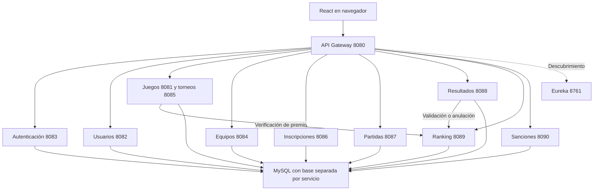

# Especificación de requisitos RankForge EP3

Revisión del 21 de noviembre de 2026. Complementa el ERS V2 histórico de EP2 con la integración React y Spring Boot. Describe los requisitos y la implementación actual, sin acreditar todavía la aceptación integrada ni el despliegue en la nube.

## Alcance y actores

El sistema administra juegos, torneos, equipos, inscripciones, partidas, resultados, clasificación, sanciones y premios. La identidad proviene de la API de autenticación y del perfil propio del servidor. Los datos de demostración EP2 no deben utilizarse como identidad ni enviarse como IDs de la API.

| Actor | Operaciones previstas |
| --- | --- |
| Visitante | Consultar catálogo, torneos, clasificación, calendario, premios publicados y avisos públicos |
| Jugador | Iniciar y cerrar sesión, editar su perfil, crear equipo, gestionar su equipo como capitán e inscribirse |
| Organizador | Aprobar inscripciones, programar partidas, registrar y validar resultados, gestionar sanciones y reconstruir clasificación |
| Administrador | Gestionar cuentas y catálogo, configurar torneos y sus estados, asignar premios y operar las funciones autorizadas de organización |

La visibilidad de un botón no concede permisos. Gateway y servicios deben rechazar solicitudes sin identidad válida o sin el rol y la propiedad necesarios.

## Requisitos funcionales y evidencia

| ID | Requisito | Implementación y límite de verificación |
| --- | --- | --- |
| RF01 | Autenticación con JWT y sesión persistente | Token firmado y vencimiento; perfil real mediante /api/usuarios/me. Falta login real en el entorno integrado |
| RF02 | Edición del perfil propio | Nombre y apodo editables; correo y rol no se cambian desde ese formulario. Pruebas con servicio simulado |
| RF03 | Equipos e integrantes | Capitán autenticado o administrador gestionan integrantes; no retirar capitán. Pruebas unitarias y de interfaz |
| RF04 | Inscripción válida | Plazo, cupo, duplicados, modalidad del juego, equipo completo y sanciones. Bloqueo por torneo implementado; concurrencia MySQL pendiente |
| RF05 | Organización de partidas | Participantes aprobados y distintos, horario ISO, ronda y controles de duplicado. Creación simultánea pendiente de endurecer |
| RF06 | Resultados verificables | Marcador no negativo, ganador coherente, edición sólo pendiente, validación y anulación justificada. Pruebas de reglas y permisos |
| RF07 | Clasificación automática | Reconstrucción desde resultados VALIDADO, reintento sin acumular puntos. Persistencia y coordinación distribuida pendientes de aceptación integrada |
| RF08 | Premios al finalizar | Asignación ADMIN, torneo FINALIZADO y correspondencia puesto/participante en ranking. Consistencia ante corrección posterior pendiente |
| RF09 | Notificaciones mínimas | Historial público persistido por torneo para cambios de estado y premios. No incluye correo, push ni bandeja privada |
| RF10 | Sanciones con vigencia | Destinatario único, severidad, motivo, fechas y cierre. Validación de existencia del destinatario todavía por completar |
| RF11 | Manejo de fallos | Carga, vacío, error, reintento y cancelación de consultas; resultado guardado se distingue de ranking no sincronizado |

## Modelo de datos y relaciones

Las bases están separadas por servicio. Cuenta de autenticación identifica el correo; Usuario representa el perfil utilizado por equipos e inscripciones. Equipo pertenece a un juego y tiene capitán e integrantes. Torneo pertenece a un juego; Inscripción vincula torneo con jugador o equipo. Partida referencia torneo y dos participantes. Resultado referencia partida. Ranking contiene estadísticas derivadas por torneo y participante. Sanción tiene un usuario o equipo como destinatario. Premio vincula torneo, posición y participante. NotificaciónTorneo registra tipo, mensaje y fecha de un evento del torneo.

Los IDs entre servicios son referencias lógicas y no claves foráneas entre bases. Su validez debe comprobarse mediante las APIs. Los tipos jugador/equipo no deben confundirse sólo porque tengan el mismo número de ID. El tipo de inscripción se determina por la configuración jugadoresPorEquipo del juego: uno permite jugador, más de uno exige equipo.

## Arquitectura de integración

El diagrama representa la estructura del código, no un despliegue comprobado. Eureka registra los servicios; el Gateway resuelve sus destinos. La comunicación interna utiliza clientes HTTP con límites de espera en los flujos corregidos.

## Requisitos no funcionales

- Seguridad: verificar firma HS256, expiración, identidad y roles; no confiar en cabeceras de rol enviadas por el navegador. No guardar secretos en Git, capturas o archivos públicos de Vite.
- Consistencia: operaciones locales transaccionales y controles de concurrencia donde corresponda. Una llamada entre servicios no constituye una transacción distribuida.
- Recuperación: conservar el resultado guardado cuando falla ranking y ofrecer sincronización posterior. Los avisos se guardan en la transacción del cambio del torneo o premio.
- Usabilidad: mensajes comprensibles y formularios con etiquetas, estados de espera y confirmación de acciones destructivas. Verificación visual EP3 por los cuatro roles aún pendiente.
- Reproducibilidad: archivo de bloqueo npm, wrappers Maven y variables de entorno documentadas. La compilación no sustituye pruebas de aceptación.

## Criterio de entrega

Frontend: instalación limpia, 149 pruebas aprobadas y build correcto en la revisión del 21 de noviembre. Cobertura de líneas 71,34 %. Es evidencia de pruebas con servicios simulados, no de cumplimiento completo de RF01–RF11.

Antes de cerrar EP3: ejecutar el protocolo EP3_ACEPTACION_INTEGRADA del backend, resolver los límites de consistencia señalados, completar DOCX y XLSX con evidencias reales, generar los dos ZIP sin secretos y revisar los PR antes de integrar main. Las capturas y estadísticas del 17 de octubre pertenecen a EP2 y no acreditan esta integración.
